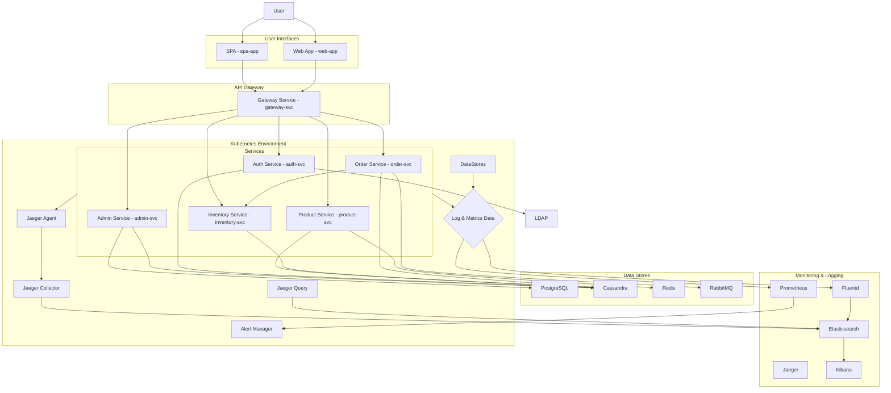

# System Overview

## 1. Introduction

This document provides a comprehensive overview of the Order Management System (OMS), including its high-level architecture, Kubernetes deployment strategy, database schemas, and key service configuration details. The system is designed as a set of microservices interacting to handle various aspects of order processing, product management, inventory, and user authentication.

## 2. High-Level Architecture

The system follows a microservice architecture pattern, with distinct services for different business capabilities. A central API Gateway manages external access to these services. User interaction is facilitated through a Single Page Application (SPA) and a traditional Web Application.



**Key Components:**

- **User Interfaces:** SPA and Web App for user interaction.
- **API Gateway (`gateway-svc`):** Single entry point for all client requests, routing to appropriate backend microservices.
- **Core Microservices:**
  - `auth-svc`: Manages user authentication and authorization (integrates with LDAP and Cassandra).
  - `admin-svc`: Provides administrative functionalities (interacts with PostgreSQL and Cassandra).
  - `product-svc`: Manages product information (uses Cassandra and Redis for caching).
  - `inventory-svc`: Manages product stock levels (uses Cassandra).
  - `order-svc`: Handles order creation and processing (uses Cassandra, RabbitMQ for async tasks, and interacts with `inventory-svc`).
- **Data Stores:**
  - PostgreSQL: Used by `admin-svc`.
  - Cassandra: Primary data store for `auth-svc`, `product-svc`, `inventory-svc`, and `order-svc`.
  - Redis: Used as a cache by `product-svc`.
  - RabbitMQ: Used by `order-svc` for asynchronous message queuing.
- **Monitoring & Logging:** A comprehensive stack including Prometheus, Jaeger, Fluentd, Elasticsearch, and Kibana for observability.

## 3. Kubernetes Deployment Architecture

The system is deployed on Kubernetes, leveraging its features for orchestration, service discovery, and scalability.

```mermaid
graph TD
    subgraph "User Access (External)"
        direction LR
        User --> NodePortServices[NodePort Services]
    end

    NodePortServices --> IngressController{Ingress (Implied/Not Defined)}
    IngressController --> GatewaySvcService[gateway-svc Service]

    subgraph "Namespace: ui"
        direction LR
        subgraph "Deployment: spa-app-pods (1 Replica)"
            SpaAppPod[Pod: spa-app]
        end
        SpaAppService[Service: spa-app (NodePort: 32105)]
        SpaAppPod --> SpaAppService

        subgraph "Deployment: web-app-pods (1 Replica)"
            WebAppPod[Pod: web-app (lb-web, web)]
        end
        WebAppService[Service: web-app (NodePort: 32100)]
        WebAppPod --> WebAppService
        NodePortServices -.-> SpaAppService
        NodePortServices -.-> WebAppService
    end

    subgraph "Namespace: service"
        direction LR
        GatewaySvcService --> GatewaySvcPod1[Pod: gateway-svc]
        GatewaySvcService --> GatewaySvcPod2[Pod: gateway-svc]
        HPA_Gateway[HPA: gateway-svc-scaler (1-3)] --> Deployment_Gateway[Deployment: gateway-svc-pods]
        Deployment_Gateway --> GatewaySvcPod1
        Deployment_Gateway --> GatewaySvcPod2


        AuthSvcService[Service: auth-svc] --> AuthSvcPod1[Pod: auth-svc]
        AuthSvcService --> AuthSvcPod2[Pod: auth-svc]
        HPA_Auth[HPA: auth-svc-scaler (1-3)] --> Deployment_Auth[Deployment: auth-svc-pods]
        Deployment_Auth --> AuthSvcPod1
        Deployment_Auth --> AuthSvcPod2
        GatewaySvcPod1 --> AuthSvcService
        GatewaySvcPod2 --> AuthSvcService

        AdminSvcService[Service: admin-svc] --> AdminSvcPod[Pod: admin-svc]
        Deployment_Admin[Deployment: admin-svc-pods (1 Replica)] --> AdminSvcPod
        GatewaySvcPod1 --> AdminSvcService
        GatewaySvcPod2 --> AdminSvcService

        ProductSvcService[Service: product-svc] --> ProductSvcPod[Pod: product-svc]
        HPA_Product[HPA: product-svc-scaler (1-3)] --> Deployment_Product[Deployment: product-svc-pods]
        Deployment_Product --> ProductSvcPod
        GatewaySvcPod1 --> ProductSvcService
        GatewaySvcPod2 --> ProductSvcService

        InventorySvcService[Service: inventory-svc] --> InventorySvcPod[Pod: inventory-svc]
        HPA_Inventory[HPA: inventory-svc-scaler (1-3)] --> Deployment_Inventory[Deployment: inventory-svc-pods]
        Deployment_Inventory --> InventorySvcPod
        GatewaySvcPod1 --> InventorySvcService
        GatewaySvcPod2 --> InventorySvcService
        OrderSvcPod1 --> InventorySvcService
        OrderSvcPod2 --> InventorySvcService


        OrderSvcService[Service: order-svc] --> OrderSvcPod1[Pod: order-svc]
        OrderSvcService --> OrderSvcPod2[Pod: order-svc]
        HPA_Order[HPA: order-svc-scaler (1-3)] --> Deployment_Order[Deployment: order-svc-pods]
        Deployment_Order --> OrderSvcPod1
        Deployment_Order --> OrderSvcPod2
        GatewaySvcPod1 --> OrderSvcService
        GatewaySvcPod2 --> OrderSvcService

        ConfigMap_Service[ConfigMap: service-config]
        Secret_Service[Secret: secret-config (Postgres)]

        AdminSvcPod --> ConfigMap_Service
        AuthSvcPod1 --> ConfigMap_Service
        GatewaySvcPod1 --> ConfigMap_Service
        ProductSvcPod --> ConfigMap_Service
        InventorySvcPod --> ConfigMap_Service
        OrderSvcPod1 --> ConfigMap_Service

        AdminSvcPod --> Secret_Service
    end

    subgraph "Namespace: data"
        direction LR
        subgraph "StatefulSet: cassandra-pods (3 Replicas)"
            CassandraPod1[Pod: cassandra-0]
            CassandraPod2[Pod: cassandra-1]
            CassandraPod3[Pod: cassandra-2]
        end
        CassandraService[Service: cassandra (Headless)]
        CassandraPod1 --> CassandraService
        CassandraPod2 --> CassandraService
        CassandraPod3 --> CassandraService
        PVC_Cassandra[PVC: cassandra-storage-claim]
        CassandraPod1 --> PVC_Cassandra
        ConfigMap_Cassandra[ConfigMap: cassandra-config]
        CassandraPod1 --> ConfigMap_Cassandra

        subgraph "Pod: postgres-pod (1 Replica)"
            PostgresPod[Pod: postgres (postgres, pg-exporter)]
        end
        PostgresService[Service: postgres (Headless)]
        PostgresPod --> PostgresService
        PVC_Postgres[PVC: local-disk-postgres-claim]
        PostgresPod --> PVC_Postgres
        Secret_Data_Postgres[Secret: secret-config (Postgres)]
        PostgresPod --> Secret_Data_Postgres

        subgraph "Pod: rabbitmq-pod (1 Replica)"
            RabbitMQPod[Pod: rabbitmq]
        end
        RabbitMQService[Service: rabbitmq (NodePort: 32104)]
        RabbitMQPod --> RabbitMQService
        PVC_RabbitMQ[PVC: local-disk-rabbitmq-claim]
        RabbitMQPod --> PVC_RabbitMQ
        NodePortServices -.-> RabbitMQService


        subgraph "Pod: redis-pod (1 Replica)"
            RedisPod[Pod: redis (redis, redis-exporter)]
        end
        RedisService[Service: redis (Headless)]
        RedisPod --> RedisService

        AuthSvcPod1 --> CassandraService
        AdminSvcPod --> CassandraService
        ProductSvcPod --> CassandraService
        InventorySvcPod --> CassandraService
        OrderSvcPod1 --> CassandraService

        AdminSvcPod --> PostgresService

        OrderSvcPod1 --> RabbitMQService
        ProductSvcPod --> RedisService
    end

    subgraph "Namespace: monitor"
        direction LR
        subgraph "DaemonSet: fluentd-pods"
            FluentdPod[Pod: fluentd (on each node)]
        end
        ConfigMap_Fluentd[ConfigMap: fluent-config]
        FluentdPod --> ConfigMap_Fluentd
        FluentdPod --> ElasticsearchService[Service: elasticsearch (Headless)]

        subgraph "Pod: elasticsearch-pod (1 Replica)"
            ElasticsearchPod[Pod: elasticsearch (elasticsearch, es-exporter)]
        end
        ElasticsearchPod --> ElasticsearchService
        PVC_Elasticsearch[PVC: local-disk-elasticsearch-claim]
        ElasticsearchPod --> PVC_Elasticsearch

        subgraph "Pod: kibana-pod (1 Replica)"
            KibanaPod[Pod: kibana]
        end
        KibanaService[Service: kibana (NodePort: 32101)]
        KibanaPod --> KibanaService
        KibanaPod --> ElasticsearchService
        NodePortServices -.-> KibanaService

        subgraph "DaemonSet: jaeger-agent-pods"
            JaegerAgentPod[Pod: jaeger-agent (on each node)]
        end
        JaegerAgentService[Service: jaeger-agent (Headless)]
        JaegerAgentPod --> JaegerAgentService
        JaegerAgentPod --> JaegerCollectorService[Service: jaeger-collector (Headless)]

        subgraph "Pod: jaeger-collector-pod (1 Replica)"
            JaegerCollectorPod[Pod: jaeger-collector]
        end
        JaegerCollectorPod --> JaegerCollectorService
        JaegerCollectorPod --> ElasticsearchService

        subgraph "Pod: jaeger-query-pod (1 Replica)"
            JaegerQueryPod[Pod: jaeger-query]
        end
        JaegerQueryService[Service: jaeger-query (NodePort: 32102)]
        JaegerQueryPod --> JaegerQueryService
        JaegerQueryPod --> ElasticsearchService
        NodePortServices -.-> JaegerQueryService


        subgraph "Pod: prometheus-pod (1 Replica)"
            PrometheusPod[Pod: prometheus]
        end
        PrometheusService[Service: prometheus (NodePort: 32103)]
        PrometheusPod --> PrometheusService
        ConfigMap_Prometheus[ConfigMap: prometheus-config]
        PrometheusPod --> ConfigMap_Prometheus
        NodePortServices -.-> PrometheusService

        PrometheusPod --> AuthSvcService
        PrometheusPod --> AdminSvcService
        PrometheusPod --> ProductSvcService
        PrometheusPod --> InventorySvcService
        PrometheusPod --> OrderSvcService
        PrometheusPod --> GatewaySvcService
        PrometheusPod --> ElasticsearchPod
        PrometheusPod --> PostgresPod
        PrometheusPod --> CassandraPod1
        PrometheusPod --> RabbitMQPod
        PrometheusPod --> RedisPod
        PrometheusPod --> JaegerAgentService
        PrometheusPod --> JaegerCollectorService
        PrometheusPod --> JaegerQueryService
    end

    classDef k8scomponent fill:#dae8fc,stroke:#6c8ebf,stroke-width:1px;
    class Deployment_Gateway,Deployment_Auth,Deployment_Admin,Deployment_Product,Deployment_Inventory,Deployment_Order,HPA_Gateway,HPA_Auth,HPA_Product,HPA_Inventory,HPA_Order k8scomponent;
    class SpaAppPod,WebAppPod,GatewaySvcPod1,GatewaySvcPod2,AuthSvcPod1,AuthSvcPod2,AdminSvcPod,ProductSvcPod,InventorySvcPod,OrderSvcPod1,OrderSvcPod2 k8scomponent;
    class CassandraPod1,CassandraPod2,CassandraPod3,PostgresPod,RabbitMQPod,RedisPod k8scomponent;
    class FluentdPod,ElasticsearchPod,KibanaPod,JaegerAgentPod,JaegerCollectorPod,JaegerQueryPod,PrometheusPod k8scomponent;
    class SpaAppService,WebAppService,GatewaySvcService,AuthSvcService,AdminSvcService,ProductSvcService,InventorySvcService,OrderSvcService k8scomponent;
    class CassandraService,PostgresService,RabbitMQService,RedisService k8scomponent;
    class ElasticsearchService,KibanaService,JaegerAgentService,JaegerCollectorService,JaegerQueryService,PrometheusService k8scomponent;
    class ConfigMap_Service,Secret_Service,ConfigMap_Cassandra,Secret_Data_Postgres,ConfigMap_Fluentd,ConfigMap_Prometheus k8scomponent;
    class PVC_Cassandra,PVC_Postgres,PVC_RabbitMQ,PVC_Elasticsearch k8scomponent;
```

**Key Aspects of Kubernetes Deployment:**

- **Namespaces:** Logical separation of components into `ui`, `service`, `data`, and `monitor` namespaces.
- **Controllers:** Deployments for stateless services, StatefulSets for Cassandra, DaemonSets for node-level agents (Fluentd, Jaeger Agent), and Pods for single-instance components.
- **Services:** Primarily ClusterIP services for internal communication. NodePort services expose UIs (`spa-app`, `web-app`), monitoring tools (Kibana, Prometheus, Jaeger), and the RabbitMQ UI externally. Headless services are used for Cassandra, PostgreSQL, Redis, and some Jaeger components for direct pod discovery.
- **Configuration:**
  - `service-config` ConfigMap provides common configuration to microservices.
  - Specific ConfigMaps for Prometheus, Fluentd, Cassandra.
  - Secrets for PostgreSQL credentials.
- **Storage:** PersistentVolumeClaims (PVCs) provide persistent storage for Cassandra, PostgreSQL, RabbitMQ, and Elasticsearch.
- **Scalability:** Horizontal Pod Autoscalers (HPAs) are configured for most backend services and the web-app, scaling based on CPU utilization.
- **Observability:** A full monitoring and logging stack is deployed within the `monitor` namespace. Prometheus scrapes metrics from services and infrastructure components. Fluentd collects logs, forwarding them to Elasticsearch. Jaeger handles distributed tracing. Kibana visualizes Elasticsearch data.

Note: The Kubernetes deployment diagram is detailed to provide a comprehensive view. For a quicker understanding of inter-service communication, refer to the High-Level Architecture diagram.

## 4. Database Schema

The system utilizes both PostgreSQL and Cassandra for data persistence. The choice of database often depends on the service and the nature of the data.

```mermaid
erDiagram
    UserAuth {
        varchar id PK "User ID (Primary Key)"
        varchar name "User's Name"
        varchar password "Hashed Password"
        varchar emailId "Email ID"
        list_text_ roles "(Cassandra) User roles"
    }

    UserRole {
        varchar id PK_FK "User ID (Part of PK, FK to UserAuth)"
        varchar role PK "Role (Part of PK)"
    }

    UserProfile {
        varchar id PK_FK "User ID (Primary Key, FK to UserAuth)"
        varchar email "Email"
        varchar name "Name"
    }

    UserAddress {
        varchar userProfileId PK_FK "User Profile ID (Part of PK, FK to UserProfile/UserAuth)"
        varchar type PK "Address Type (Part of PK, e.g., Shipping, Billing)"
        int id PK "(SQL) Address ID (Part of PK)"
        varchar street "Street Address"
        varchar area "Area"
        varchar city "City"
        varchar state "State"
        varchar country "Country"
        varchar contactName "Contact Name"
        varchar contactTelephone "Contact Telephone"
        varchar contactEmail "Contact Email"
    }

    Product {
        varchar id PK "Product ID (Primary Key)"
        varchar name "Product Name"
        varchar imageUrl "Image URL"
        numeric price "(SQL) Product Price"
        float price_cass "(Cassandra) Product Price"
    }

    Cart {
        varchar id PK "(SQL Only) Cart ID (Primary Key)"
    }

    CartLine {
        varchar cartId PK_FK "Cart ID (Part of PK, FK to Cart)"
        int cartLineId PK "Cart Line ID (Part of PK)"
        varchar productId FK "Product ID (FK to Product)"
        int quantity_sql "(SQL) Quantity"
        float quantity_cass "(Cassandra) Quantity"
    }

    OrderMaster {
        varchar id PK "(SQL Only) Order ID (Primary Key)"
        varchar userId FK "User ID (FK to UserAuth)"
        varchar status "Order Status"
        date createdDate "Date order was created"
        time createdTime "Time order was created"
    }

    OrderLine {
        varchar orderId PK_FK "(SQL) Order ID (Part of PK, FK to OrderMaster)"
        varchar orderLineId_sql PK "(SQL) Order Line ID (Part of PK)"
        varchar userId_cass PK "(Cassandra) User ID (Part of PK)"
        varchar id_cass PK "(Cassandra) Order ID (Part of PK)"
        int orderLineId_cass PK "(Cassandra) Order Line ID (Part of PK)"
        varchar productId FK "Product ID (FK to Product)"
        int quantity_sql "(SQL) Quantity"
        float quantity_cass "(Cassandra) Quantity"
        varchar status_cass "(Cassandra) Line Item Status"
        date createdDate_cass "(Cassandra) Date line item was created"
        time createdTime_cass "(Cassandra) Time line item was created"
    }

    Inventory {
        varchar productId PK_FK "Product ID (Primary Key, FK to Product)"
        numeric quantity_sql "(SQL) Quantity in stock"
        float quantity_cass "(Cassandra) Quantity in stock"
    }

    UserAuth ||--o{ UserRole : "has (SQL)"
    UserAuth ||--|| UserProfile : "identifies (FK in SQL)"
    UserAuth ||--o{ UserAddress : "has (FK to UserProfile in SQL, direct in Cassandra)"
    UserAuth ||--o{ OrderMaster : "places (SQL)"

    Cart ||--o{ CartLine : "contains (SQL)"
    OrderMaster ||--o{ OrderLine : "details (SQL)"

    Product ||--o{ CartLine : "appears in"
    Product ||--o{ OrderLine : "appears in"
    Product ||--|| Inventory : "stocks"

    %% Relationships based on Cassandra structure (may overlap or differ from SQL)
    %% UserAuth links to UserProfile and UserAddress conceptually in Cassandra too, often by shared ID.
    %% OrderLine in Cassandra has userId, effectively linking to UserAuth.
    %% Product is linked from CartLine, OrderLine, Inventory in Cassandra.

    note "Dashed lines or notes can indicate conceptual links where FKs aren't explicit (common in NoSQL)."
    note "Fields suffixed with _sql or _cass indicate they are specific to that DB's schema definition if they differ."
    note "Primary Keys are denoted by PK. Foreign Keys by FK."
    note "Cassandra OrderLine has a composite PK (userId, id, orderLineId) and includes status/timestamp details per line."
    note "SQL OrderMaster holds header status/timestamp, SQL OrderLine is simpler."

```

**Schema Details:**

- **User Management (`UserAuth`, `UserRole`, `UserProfile`, `UserAddress`):** Handles user credentials, roles, profile information, and addresses. `UserAuth` has slightly different structures in SQL (separate `UserRole` table) and Cassandra (roles as a list within `UserAuth`).
- **Product (`Product`):** Stores product details.
- **Cart (`Cart`, `CartLine`):** Manages shopping cart contents. The `Cart` table itself is only in the SQL schema.
- **Order (`OrderMaster`, `OrderLine`):** Stores order information. The structure differs significantly between SQL (master-detail) and Cassandra (denormalized `OrderLine` per user).
- **Inventory (`Inventory`):** Tracks product stock levels.

The `admin-svc` primarily interacts with the PostgreSQL schema, while services like `auth-svc`, `product-svc`, `inventory-svc`, and `order-svc` are configured to use Cassandra in the Kubernetes environment.

## 5. Service Configuration Notes

Analysis of local service configurations (`config.properties`) versus the Kubernetes deployment configurations (derived from ConfigMaps and service YAMLs) reveals several important differences that developers should be aware of. The Kubernetes configuration generally takes precedence in a deployed environment.

- **Database Type (`database.type`):**
  - Local configs often default to `SQL`.
  - Kubernetes configs specify:
    - `admin-svc`: `ALL` (though local is `SQL`)
    - `auth-svc`: `CQL` (local is `SQL`)
    - `inventory-svc`: `CQL` (local is `SQL`)
    - `order-svc`: `CQL` (local is `SQL`)
    - `product-svc`: `CQL` (local is `SQL`)
- **Jaeger Tracing (`opentracing.jaeger.enabled`):**
  - Disabled in all local `config.properties`.
  - Enabled globally in the Kubernetes `service-config` ConfigMap.
- **Eureka Service Discovery (`eureka.client.registerWithEureka`, `eureka.client.fetchRegistry`):**
  - Disabled in all local `config.properties` and in the Kubernetes `service-config` ConfigMap. The system relies on Kubernetes DNS for service discovery. The `discovery-svc` (Eureka server) is deployed but not actively used by other services for registration.
- **Order Service Asynchronous Processing (`order.process.async`, `order.queue.type`):**
  - `order-svc` local config: `order.process.async=false`, `order.queue.type=local`.
  - Kubernetes `service-config`: `order.process.async=true`, `order.queue.type=rabbitmq`. This means orders are processed asynchronously using RabbitMQ in Kubernetes.
- **Product Service Redis Cache (`redis.enabled`):**
  - `product-svc` local config: `redis.enabled=false`.
  - Kubernetes `service-config`: `redis.enabled=true`. Redis caching is active for the product service in Kubernetes.
- **Gateway Configuration (`gateway-svc`):**
  - The `gateway-svc` has multiple local configuration files for routing (Zuul in `config.properties`, Spring Cloud Gateway in various YAML profiles like `config.yml`, `config-discovery.yml`, `config-k8s.yml`).
  - The Kubernetes `service-config` ConfigMap includes Ribbon properties (e.g., `AdminSvc.ribbon.listOfServers`) which are referenced by Kubernetes service names (e.g., `http://admin-svc:80`). While the `config-k8s.yml` profile seems most appropriate for a Kubernetes environment by using service DNS names, the exact Spring profile activated at runtime in Kubernetes (if not default) would definitively determine the routing logic. It's crucial that the gateway correctly resolves backend services using Kubernetes service discovery.

These differences highlight that the system behaves differently in a local development setup compared to the Kubernetes deployment. The documentation and diagrams provided reflect the intended Kubernetes operational state.
